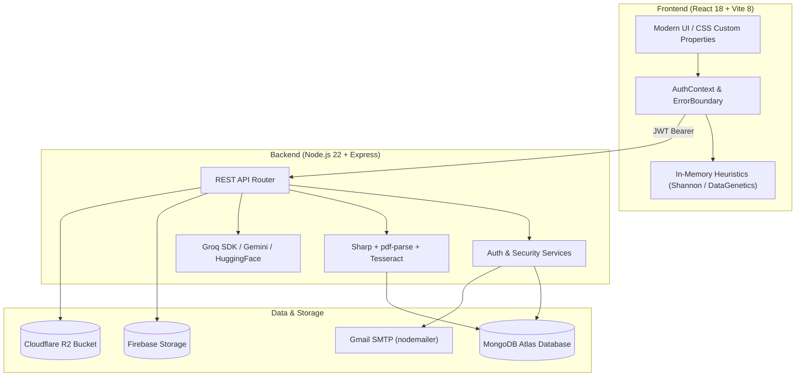

# DocVault — Comprehensive Architecture & Engineering Project Report

> **Target Audience:** Engineering Team, AI Agents (Claude / Antigravity), and Technical Contributors.  
> **Repository:** `https://github.com/AkshatMishra29/DocVault-New`  
> **Status:** Production-Ready / Stable (v2.5.0)  

---

## 1. Executive Summary & Product Vision

**DocVault** is an intelligent, zero-knowledge personal document and asset vault designed to organize, extract, protect, and query life's critical documents (passports, property deeds, health insurance policies, vehicle titles, warranties, and financial statements).

Unlike standard cloud storage platforms (Dropbox, Google Drive), DocVault is engineered around two core pillars:
1. **Dual-Tier Zero-Knowledge Isolation:** Authentication is strictly split into two layers:
   - **Tier 1 (Master Account):** Verified via email/password + Native MongoDB 6-digit OTP verification.
   - **Tier 2 (Vault PIN & WebAuthn Biometrics):** A secondary 4 or 6-digit numeric PIN or hardware biometric key (Touch ID/Face ID) unlocks client-side file decryption and session keys.
2. **Grounded In-Memory AI & OCR:** Multi-page PDF streaming and image preprocessing pipelines (Sharp + Tesseract) extract text into MongoDB, powering an AI Copilot (Groq LLMs & Google Gemini) that answers questions grounded strictly in the user's verified files with zero hallucinations and zero external credential leakage.

---

## 2. Complete Technology Stack



### 2.1 Frontend Architecture
- **Framework:** React 18.2 with Vite 8.3 (ultra-fast ESM bundling & HMR).
- **Routing:** `react-router-dom` v6 with `ProtectedRoute` multi-tier guards.
- **State Management:** Native React Context (`AuthContext`) managing user session, vault unlock state, token lifecycle, and auto-lock listeners.
- **Icons & Visuals:** `lucide-react` modern icon library.
- **Styling:** Modular vanilla CSS using CSS custom properties (`tokens.css`, `globals.css`) supporting seamless Dark and Light themes.
- **Fault-Tolerance:** Root-level React `ErrorBoundary` with fallback error card and one-click session reset.
- **Local Security Evaluators:** Pure client-side math routines:
  - Shannon Entropy calculator (`passwordStrengthService.js`)
  - DataGenetics empirical PIN pattern analyzer (`pinSecurityService.js`)
  - WebAuthn Hardware Enclave API (`navigator.credentials`)

### 2.2 Backend Architecture
- **Runtime:** Node.js 22.x (ESM modules `"type": "module"`).
- **Web Framework:** Express.js 4.x with RESTful routing.
- **Database ORM:** Mongoose 8.x for MongoDB schema modeling and TTL indexing.
- **Authentication & Cryptography:** `bcryptjs` (salt rounds: 10), `jsonwebtoken` (JWT), and Node.js native `crypto`.
- **Email Delivery:** `nodemailer` with Gmail SMTP transport.
- **File Ingestion:** `multer` memory storage (RAM buffers) for zero disk leakage.

### 2.3 Storage & Cloud Infrastructure
- **Primary Database:** MongoDB Atlas (AWS cluster, multi-region failover).
- **Cloud Object Storage:** Firebase Cloud Storage (Google Cloud Storage bucket) with fallback to Cloudflare R2 (AWS S3-compatible).
- **Service Account Security:** Google Firebase Admin SDK initialized via JSON service credentials.

### 2.4 AI & Document Processing
- **LLM Reasoning Engine:** Groq Cloud SDK (`qwen/qwen3.8-27b` / `llama-3.3-70b-versatile`) and Google Gemini API (`GEMINI_API_KEY`).
- **Embedding Generation:** Hugging Face Inference API (`BAAI/bge-small-en-v1.5`) for vector representations.
- **OCR Pipeline:** `pdf-parse` v2 (stream buffers), `sharp` (greyscale contrast normalization), and `tesseract.js` (fallback neural OCR).

---

## 3. High-Level Folder Structure

```
DOCVAULT/
├── PROJECT_REPORT.md            # This master architectural report
├── UPDATE_LOG.md                # Chronological engineering changelog
├── README.md                    # Quickstart guide
├── .gitignore                   # Multi-tier ignore rules (Strictly protects .env & secrets)
│
├── backend/                     # Node.js + Express REST API Server
│   ├── .env                     # Local secrets (NEVER committed to git)
│   ├── .env.example             # Documented environment variable template
│   ├── package.json             # Backend dependencies & npm scripts
│   ├── firebase-service-account.json # Google Cloud Admin credentials (ignored)
│   └── src/
│       ├── app.js               # Express application configuration & middleware
│       ├── server.js            # Server entry point (Port 5001 & DB connection)
│       ├── config/
│       │   └── index.js         # Centralized environment variable loader
│       ├── middleware/
│       │   ├── auth.middleware.js   # JWT validation & sessionVersion guard
│       │   └── upload.middleware.js # Multer in-memory upload handler
│       ├── models/
│       │   └── index.js         # Unified Mongoose models export
│       ├── modules/             # Domain-Driven Modules
│       │   ├── auth/            # Authentication, OTP, PIN, & Biometrics
│       │   │   ├── auth.controller.js
│       │   │   ├── auth.model.js       # User schema & security preferences
│       │   │   ├── auth.routes.js      # /api/auth routes
│       │   │   ├── auth.service.js     # Bcrypt, JWT, lockout & PIN logic
│       │   │   └── otp.model.js        # 10-minute TTL OTP schema
│       │   ├── ai/              # AI Assistant & Copilot Routes
│       │   │   └── ai.routes.js        # /api/ai/ask grounded RAG queries
│       │   ├── documents/       # Document Upload, Retrieval & OCR
│       │   │   ├── document.model.js
│       │   │   └── document.routes.js
│       │   ├── assets/          # Physical & Financial Asset Registry
│       │   │   ├── asset.model.js
│       │   │   └── asset.routes.js
│       │   ├── deadlines/       # Expiry, Warranty & Policy Renewal Tracking
│       │   │   ├── deadline.model.js
│       │   │   └── deadline.routes.js
│       │   └── vault/           # Audit Logs & Encrypted JSON Backup Export
│       │       ├── auditLog.model.js
│       │       └── vault.routes.js
│       ├── services/
│       │   ├── emailService.js  # Nodemailer Gmail SMTP dispatcher
│       │   ├── ai/
│       │   │   ├── groqService.js       # Groq Cloud LLM queries
│       │   │   └── huggingFaceService.js # Vector embeddings
│       │   ├── ocr/
│       │   │   └── ocrService.js        # Sharp + pdf-parse + Tesseract
│       │   └── storage/
│       │       ├── firebaseService.js   # Firebase Storage bucket handler
│       │       └── cloudflareR2Service.js # Cloudflare R2 S3 fallback
│       └── utils/
│           └── sanitize.js      # Input sanitization and XSS protection
│
└── frontend/                    # React 18 + Vite Web Application
    ├── package.json             # Frontend dependencies & npm scripts
    ├── vite.config.js           # Vite build & plugin settings
    ├── index.html               # Web root entry point
    └── src/
        ├── main.jsx             # React DOM root render & theme bootstrapper
        ├── app/
        │   ├── App.jsx          # Root component wrapped with ErrorBoundary
        │   ├── providers.jsx    # Context providers (AuthProvider)
        │   └── routes.jsx       # Route definitions & ProtectedRoute gates
        ├── components/
        │   ├── common/          # Reusable UI Atoms
        │   │   ├── Badge/
        │   │   ├── Button/
        │   │   ├── Card/
        │   │   ├── DocVaultLogo/
        │   │   ├── EmptyState/
        │   │   ├── ErrorBoundary/ # Production application recovery UI
        │   │   ├── Input/
        │   │   └── Modal/
        │   └── layout/          # Shell Layout Components
        │       ├── AppHeader/   # Top header with user email, Lock Vault, Logout
        │       ├── AppLayout/   # Responsive application shell
        │       ├── AppSidebar/  # Desktop sidebar navigation
        │       ├── BottomNav/   # Mobile bottom navigation bar
        │       ├── PublicFooter/# Landing page footer
        │       └── PublicNavbar/# Landing page navbar (Dynamic login/overview buttons)
        ├── features/            # Feature-Sliced Application Modules
        │   ├── auth/            # Authentication & Vault Unlock
        │   │   ├── components/  # ProtectedRoute.jsx
        │   │   ├── context/     # AuthContext.jsx (Session state, auto-lock)
        │   │   └── pages/       # LoginPage, RegisterPage, EnterPinPage, AuthVerifiedPage
        │   ├── landing/         # Public Marketing Landing Page
        │   │   ├── LandingPage.jsx
        │   │   └── LandingPage.css
        │   ├── dashboard/       # Vault Overview & Settings
        │   │   ├── HomePage.jsx # Dashboard summary, stats, recent docs
        │   │   └── MorePage.jsx # Account security settings, biometrics, export
        │   ├── documents/       # Document Explorer & Document Viewer
        │   ├── upload/          # Multi-file Drag & Drop + Live OCR processing
        │   ├── assets/          # Asset management & document linking
        │   ├── deadlines/       # Renewal calendar & automated alerts
        │   ├── ai-assistant/    # Grounded Ask AI Chat Interface
        │   └── shield/          # Standalone Security Suite & Services
        │       ├── DocVaultShieldPage.jsx
        │       └── services/
        │           ├── passwordStrengthService.js # Shannon entropy analyzer
        │           ├── pinSecurityService.js      # DataGenetics PIN evaluator
        │           ├── hibpService.js             # HIBP k-Anonymity breach checker
        │           └── passwordGeneratorService.js # CSPRNG password generator
        ├── services/
        │   ├── api/             # Fetch client with Bearer JWT interceptor
        │   └── firebase.js      # Client Firebase auth & storage bindings
        └── styles/
            ├── tokens.css       # Design tokens (Colors, shadows, spacing)
            ├── globals.css      # Dark/Light theme variables & resets
            ├── typography.css   # Fonts & text scales
            └── animations.css   # Keyframes & micro-interactions
```

---

## 4. Key Architectural Flows & Security Mechanics

### 4.1 Two-Tier Authentication & Session State Flow

```
[User Visits /register]
          │
          ▼
Step 1: Enters Name, Email, Password, PIN (4 or 6 digits)
          │  (Evaluated locally in-memory: Shannon entropy & DataGenetics)
          ▼
POST /api/auth/send-otp
          │
          ├──> 6-Digit random code generated
          ├──> Bcrypt hash saved in MongoDB (10-minute auto-expiring TTL)
          └──> Dispatched via Gmail SMTP (nodemailer)
          │
          ▼
Step 2: User Enters 6-Digit OTP on Verification Screen
          │
          ▼
POST /api/auth/verify-otp (or directly in POST /api/auth/register)
          │
          ├──> Bcrypt verification of OTP (Rate-limited: 5 attempts max)
          ├──> User account created with separate passwordHash and pinHash
          └──> Token returned & Session initialized -> Vault Unlocked
```

```
[User Visits /login]
          │
          ▼
Enters Email & Master Password
          │
          ▼
POST /api/auth/login
          │
          ├──> Validates email & passwordHash
          ├──> Returns requiresPin: true + token (Tier 1 access)
          └──> Frontend marks isVaultUnlocked = false -> Navigates to /enter-pin
          │
          ▼
[User on /enter-pin Screen]
          │
          ├──> Option A: Enters 4/6-Digit Vault Security PIN
          └──> Option B: Touch ID / Fingerprint via WebAuthn API
          │
          ▼
POST /api/auth/verify-pin
          │
          ├──> Bcrypt verification of pinHash
          ├──> If 5 incorrect attempts: Locks vault for 5 minutes (HTTP 423)
          └──> If correct: returns full session token -> isVaultUnlocked = true -> /dashboard
```

### 4.2 Auto-Lock & Device Sleep Engine
In `frontend/src/features/auth/context/AuthContext.jsx`:
- **Inactivity Timer:** Every 15 seconds, checks if more than 10 minutes have elapsed since the last user interaction (`mousedown`, `keydown`, `touchstart`, `scroll`).
- **Device Sleep / Backgrounding:** Standard JavaScript timers freeze when a smartphone sleeps or a laptop lid closes. DocVault attaches to `document.addEventListener('visibilitychange')` and `window.addEventListener('focus')`. Upon wakeup, elapsed real time is computed immediately against `dv_last_activity_time`; if $\ge 10\text{ minutes}$, `lockVault()` executes instantaneously.

### 4.3 Brute-Force Rate Limiting
- **PIN Verification:** Handled in `backend/src/modules/auth/auth.service.js`. After 5 consecutive failed attempts, `user.lockUntil = new Date(Date.now() + 5 * 60 * 1000)` is saved. The API responds with `HTTP 423 Locked`. The frontend displays a live countdown timer (`4:59`, `4:58`...) and locks keypad input.
- **OTP Verification:** Handled in `backend/src/modules/auth/otp.model.js`. Maximum 5 attempts allowed per OTP. On the 5th failed attempt, the record is immediately purged from MongoDB.

### 4.4 Single Active Session Enforcement
- The `User` model stores an integer `sessionVersion` (default `1`) and a boolean `singleSessionOnly`.
- When enabled in settings, whenever the user logs in from a new browser or device, `sessionVersion` increments by `+1`.
- Any prior active tokens bearing an older `sessionVersion` are rejected on subsequent API calls with `401 Unauthorized: Session terminated by another active login`.

---

## 5. Core Data Models (MongoDB Mongoose)

### 5.1 User Model (`backend/src/modules/auth/auth.model.js`)
```javascript
{
  name: { type: String, required: true },
  email: { type: String, required: true, unique: true, lowercase: true },
  passwordHash: { type: String, required: true },
  pinHash: { type: String, required: true },
  pinLength: { type: Number, enum: [4, 6], default: 4 },
  phone: { type: String, default: '' },
  tier: { type: String, enum: ['free', 'pro', 'enterprise'], default: 'free' },
  singleSessionOnly: { type: Boolean, default: false },
  sessionVersion: { type: Number, default: 1 },
  autoLockEnabled: { type: Boolean, default: true },
  biometricsEnabled: { type: Boolean, default: false },
  failedAttempts: { type: Number, default: 0 },
  lockUntil: { type: Date, default: null }
}
```

### 5.2 Document Model (`backend/src/modules/documents/document.model.js`)
```javascript
{
  userId: { type: mongoose.Schema.Types.ObjectId, ref: 'User', required: true },
  title: { type: String, required: true },
  category: { type: String, enum: ['identity', 'health', 'finance', 'assets', 'legal', 'other'], default: 'other' },
  fileUrl: { type: String, required: true },
  fileType: { type: String },
  fileSize: { type: Number },
  extractedText: { type: String, default: '' },
  tags: [{ type: String }],
  expiryDate: { type: Date },
  createdAt: { type: Date, default: Date.now }
}
```

### 5.3 OTP Verification Model (`backend/src/modules/auth/otp.model.js`)
```javascript
{
  email: { type: String, required: true, lowercase: true, index: true },
  otpHash: { type: String, required: true },
  purpose: { type: String, enum: ['register', 'login', 'reset-pin'], default: 'register' },
  attempts: { type: Number, default: 0 },
  expiresAt: { type: Date, required: true, index: { expires: 0 } } // MongoDB TTL index
}
```

### 5.4 Asset Model (`backend/src/modules/assets/asset.model.js`)
```javascript
{
  userId: { type: mongoose.Schema.Types.ObjectId, ref: 'User', required: true },
  name: { type: String, required: true },
  category: { type: String, enum: ['real_estate', 'vehicle', 'appliance', 'electronics', 'jewelry', 'other'] },
  estimatedValue: { type: Number },
  currency: { type: String, default: 'USD' },
  purchaseDate: { type: Date },
  warrantyExpiryDate: { type: Date },
  linkedDocuments: [{ type: mongoose.Schema.Types.ObjectId, ref: 'Document' }]
}
```

---

## 6. API Route Contracts

| Method | Endpoint | Auth Required | Description |
| :--- | :--- | :---: | :--- |
| `POST` | `/api/auth/send-otp` | Public | Generates 6-digit OTP, saves bcrypt hash in Mongo, emails user |
| `POST` | `/api/auth/verify-otp` | Public | Verifies submitted 6-digit code against Mongo TTL record |
| `POST` | `/api/auth/register` | Public | Validates OTP & registers user with passwordHash & pinHash |
| `POST` | `/api/auth/login` | Public | Authenticates email & password; triggers Step 2 PIN challenge |
| `POST` | `/api/auth/verify-pin` | Public/JWT | Verifies Vault PIN; returns unlocked session token |
| `GET` | `/api/documents` | Protected (JWT) | Lists user documents with search, tags, and category filters |
| `POST` | `/api/documents/upload` | Protected (JWT) | Multipart upload -> Sharp/OCR extraction -> Storage bucket |
| `GET` | `/api/deadlines` | Protected (JWT) | Retrieves upcoming document & warranty expiration deadlines |
| `GET` | `/api/assets` | Protected (JWT) | Retrieves registered assets and cross-linked document IDs |
| `POST` | `/api/ai/ask` | Protected (JWT) | Grounded RAG query against user's OCR extracted documents |
| `GET` | `/api/vault/export` | Protected (JWT) | Generates complete encrypted JSON export of user's vault |

---

## 7. Guidelines for Claude & AI Agents Adding New Features

When extending DocVault, adhere strictly to these engineering principles:

1. **Preserve Two-Tier Security:**
   - Any sensitive user data (documents, assets, audit logs) must reside inside `<ProtectedRoute>` in `routes.jsx`.
   - Never expose decrypted document links or sensitive vault fields to unauthenticated routes.
2. **Client-Side In-Memory Heuristics:**
   - Never send raw passwords, temporary PIN tests, or unhashed credentials across the network for validation. Use the pure client-side mathematical routines in `frontend/src/features/shield/services/`.
3. **Database TTL & Cleanup:**
   - Temporary tokens or OTP codes must utilize MongoDB TTL indexes (`expiresAfterSeconds: 0`) and bcrypt hashing.
4. **Resilient LocalStorage Deserialization:**
   - Always wrap `localStorage.getItem()` and `sessionStorage.getItem()` in `try/catch` blocks inside `AuthContext.jsx` or custom hooks to prevent JSON syntax crash loops.
5. **Environment Variable Hygiene:**
   - NEVER commit `.env` files. Always update `.env.example` with generic placeholders and expose variables via `backend/src/config/index.js`.
6. **Adding a New Domain Feature:**
   - **Backend:** Create module under `backend/src/modules/<feature>/` (`model.js`, `routes.js`, `controller.js`) and mount in `backend/src/app.js`.
   - **Frontend:** Create module under `frontend/src/features/<feature>/`, declare routes in `frontend/src/app/routes.jsx`, and add navigation link in `AppSidebar.jsx` and `BottomNav.jsx`.
   - **Verification:** Always verify build sanity using `npm --prefix frontend run build`.

