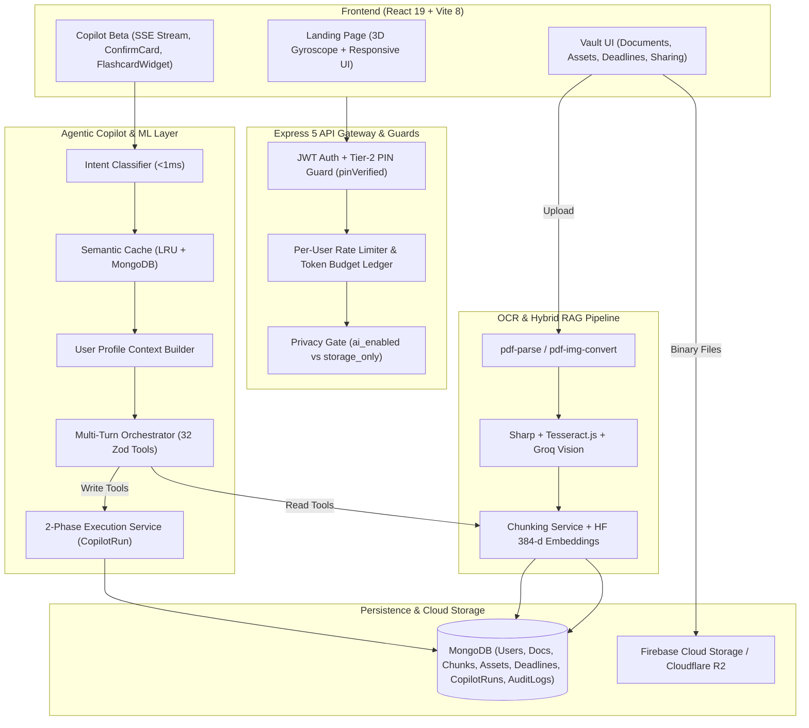

<div align="center">

# 🛡️ DocVault 2.0
### Privacy-First Personal Document Vault & Agentic AI Copilot

[](https://react.dev/)
[](https://nodejs.org/)
[](https://www.mongodb.com/)
[](https://groq.com/)
[](https://firebase.google.com/)
[](https://jwt.io/)

<br/>

<p align="center">
  <b>DocVault</b> unifies scattered personal documents—insurance policies, warranties, medical records, tax invoices, and government IDs—into a single <b>PIN-protected vault</b> powered by a <b>privacy-isolated Agentic AI Copilot</b>, <b>Hybrid RAG retrieval</b>, and <b>automated renewal tracking</b>.
</p>

[Why DocVault](#-why-docvault) •
[Core Features](#-core-features) •
[AI & Agentic Architecture](#-ai-engineering--agentic-architecture) •
[System Architecture](#-system-architecture) •
[Tech Stack](#-tech-stack) •
[Project Structure](#-project-structure) •
[Security & Privacy](#-security--privacy-model) •
[API Reference](#-api-reference) •
[Quickstart](#-quickstart)

</div>

---

## 📖 Why DocVault?

Most people store critical life documents across WhatsApp chats, email attachments, and cluttered phone folders. Existing tools force a compromise:

| Traditional Cloud Drives | Generic Public AI Chatbots | **DocVault 2.0** |
| :--- | :--- | :--- |
| Passive file dumps; no field extraction, expiry alerts, or asset linking. | No privacy boundaries; sensitive IDs are exposed to third-party prompts, and outputs often hallucinate. | **PIN-locked private vault** + **per-document AI isolation (`STORAGE_ONLY` vs `ai_enabled`)** + **grounded Hybrid RAG & Agentic Copilot** with human-in-the-loop approval. |

---

## ✨ Core Features

### 1. Dual-Tier Security & Vault Access
- **Tier 1 — Identity Auth**: Email/password (`bcryptjs`) and **Google OAuth** (Firebase Admin).
- **Tier 2 — Vault PIN & WebAuthn Biometrics**: Browsing documents or invoking AI requires clearing a 4–6 digit Vault PIN (`pinVerified: true` in JWT) or hardware WebAuthn biometrics.
- **Instant Lock & Multi-Session Switcher**: Lock anytime (`Cmd/Ctrl + L`) or switch accounts cleanly without token bleed.

### 2. Privacy-First Document Management (`/documents`)
- **Per-Document Privacy Modes**:
  - `STORAGE_ONLY`: Zero AI processing, zero chunking, zero embedding—pure encrypted storage.
  - `AI_ENABLED`: Unlocks OCR extraction, metadata structuring, and Copilot Q&A.
- **Private vs. Shared Visibility**: Filter instantly by `All Access`, `Private`, `Shared`, or `Storage Only`, with clear `Private` / `Shared` badges in both Grid and Table views.
- **Multi-Tier Ingestion & OCR Cascade**: `pdf-parse` (digital PDFs) → `pdf-img-convert` + `sharp` preprocessing → `tesseract.js` OCR → Groq multimodal vision fallback for degraded/blurry smartphone photos.

### 3. Agentic DocVault Copilot (`/copilot`)
- **Fresh Session on Open**: Opens on a clean chat canvas every time while preserving searchable conversation history in a collapsible, drag-resizable sidebar.
- **In-Chat Interactive Workflows**:
  - **Upload Intake Card**: Drop files directly into chat to choose `Storage Only` vs. `AI-Enabled` and auto-generate flashcards.
  - **Interactive Flashcard Builder**: Pre-fills asset/warranty flashcards from documents right inside the conversation.
  - **Verified Source Chips**: Clickable page-grounded citations with inline preview, edit, and delete controls.
  - **Human-in-the-Loop Confirmation Cards**: Every write/delete action pauses for explicit user approval before touching the database.

### 4. Asset Flashcards, Deadlines & Family Sharing
- **Asset Registry (`/assets`)**: Group receipts, policies, and warranties under real-world assets (Vehicles, Electronics, Property) with custom fields and warranty countdowns.
- **Deadline Engine (`/deadlines`)**: Tracks policy renewals and expirations with **RFC-5545 `.ics` Calendar Feed** export for Apple, Google, and Outlook calendars.
- **Controlled Sharing (`/sharing`)**: Connect via DocVault ID and share documents with `view` or `download` permissions, optional expiration dates, and instant revocation.
- **Mobile-First Responsive UI**: Code-split React routes, adaptive dark/light themes, mobile bottom navigation, and gyroscope-driven 3D motion on the landing experience.

---

## 🧠 AI Engineering & Agentic Architecture

DocVault's AI subsystem (`backend/src/modules/copilot/`) is engineered for **accuracy, low latency, token efficiency, and strict safety**:

### 1. Multi-Turn Agentic Orchestrator (`orchestrator.js`)
- Streams responses over **Server-Sent Events (SSE)** (`text_delta`, `tool_started`, `tool_result`, `sources`, `confirmation_required`, `flashcard_draft`, `done`).
- Runs a bounded reasoning loop (`MAX_ITERATIONS = 6`, `TIMEOUT_MS = 90s`, `HISTORY_WINDOW = 14` messages) with automatic synthesis enforcement on turn 5+.
- **Model Resilience (`groqAdapter.service.js`)**: Uses verified Groq models (`qwen/qwen3.8-27b` primary, `openai/gpt-oss-120b` fallback, `openai/gpt-oss-20b` fast) with automatic 5-minute 429 rate-limit cooldown switching.

### 2. 32 Zod-Validated Read & Write Tools (`tools/registry.js`)
All tools are strictly typed with **Zod** schemas converted dynamically to OpenAI/Groq function-calling JSON schemas:
- **Read Tools**: `search_documents`, `ask_documents`, `summarize_document`, `compare_documents`, `extract_fields`, `list_deadlines`, `list_assets`, `list_study_decks`, `list_shares`, `lookup_docvault_id`, `get_vault_stats`, `propose_flashcard_form`.
- **Write Tools (2-Phase Confirmation)**: `create_asset`, `update_asset`, `delete_asset`, `link_document_to_asset`, `unlink_document`, `create_reminder`, `update_reminder`, `complete_reminder`, `delete_reminder`, `update_document_metadata`, `create_document_version`, `create_document` (server-side PDF via `pdf-lib`), `delete_document`, `create_study_deck`, `edit_study_deck`, `remove_study_deck_cards`, `send_connection_request`, `create_share`, `revoke_share`, `suggest_share_pack`.

### 3. Human-in-the-Loop Execution (`CopilotRun` + `execution.service.js`)
Write tools **never** execute inside the LLM loop:
1. The orchestrator intercepts any `kind: 'write'` tool call and creates a `CopilotRun` record (`status: 'awaiting_approval'`, `idempotencyKey`).
2. The UI renders an interactive `ConfirmCard` for the user.
3. Only when the user clicks **Approve** (`POST /api/copilot/runs/:id/approve`), the backend atomically locks the run (`awaiting_approval` → `executing`), re-verifies ownership/permissions, executes the mutation, records an `AuditLog`, and invalidates cached user profile context.

### 4. Hybrid RAG & ML Acceleration Layer
```
User Query
   │
   ├─► [1. Intent Classifier (<1ms)] ──► Classifies into 9 intents (search, deadline, compare, share, flashcard, study, upload, delete, stats)
   │                                      Injects preferred tools hint into orchestrator
   ├─► [2. Semantic Answer Cache] ─────► Embeds query (BAAI/bge-small-en-v1.5, 384-dim)
   │                                      Cosine similarity >= 0.92? ─► Instant cached answer (0 LLM tokens)
   ├─► [3. User Profile Injection] ────► Injects vault summary (top categories, recent docs, upcoming deadlines)
   │                                      Reduces tool-calling turns from 3–4 down to 1–2
   └─► [4. Hybrid Chunk Retrieval] ────► Combines keyword matching + 384-dim vector similarity over DocumentChunks
                                          Wraps evidence in <untrusted_document_data> tags
```

---

## 🏗️ System Architecture



---

## 🛠️ Tech Stack

| Layer | Technologies |
| :--- | :--- |
| **Frontend** | React 19, Vite 8 (lazy code-splitting), React Router 7, Lucide Icons, `react-markdown`, `remark-gfm`, `@react-oauth/google`, Firebase Client SDK |
| **Backend** | Node.js (ESM), Express 5, Mongoose 9, Zod 4, JWT, `bcryptjs`, Multer, `pdf-lib`, `nodemailer` |
| **AI & ML** | Groq SDK (`qwen/qwen3.8-27b`, `openai/gpt-oss-120b`, `openai/gpt-oss-20b`), Hugging Face Embeddings (`BAAI/bge-small-en-v1.5`), `@huggingface/transformers`, Custom Hybrid RAG, Semantic Vector Cache, Intent Classifier |
| **OCR & Media** | `pdf-parse`, `pdf-img-convert`, `sharp`, `tesseract.js`, Groq Vision fallback |
| **Database & Storage** | MongoDB / MongoDB Atlas, Firebase Admin & Cloud Storage, AWS S3 SDK (Cloudflare R2 compatible) |

---

## 📂 Project Structure

```text
DOCVAULT/
├── backend/
│   ├── src/
│   │   ├── config/                  # Env config, Groq/HF/Firebase/Pipeline caps
│   │   ├── middleware/              # JWT + PIN auth & Multer upload guards
│   │   ├── modules/
│   │   │   ├── auth/                # Login, Register, Google OAuth, Vault PIN, WebAuthn
│   │   │   ├── copilot/             # Agentic Copilot module
│   │   │   │   ├── models/          # CopilotMessage, CopilotRun, DocumentChunk, StudyDeck
│   │   │   │   ├── services/        # groqAdapter, semanticCache, userProfile, intentClassifier, chunking, execution
│   │   │   │   ├── tools/           # registry.js (32 read/write tools)
│   │   │   │   ├── orchestrator.js  # SSE streaming agent loop
│   │   │   │   └── copilot.routes.js
│   │   │   ├── documents/           # Upload, OCR cascade, metadata, privacy modes
│   │   │   ├── assets/              # Asset flashcards & linked documents
│   │   │   ├── deadlines/           # Expiry reminders & RFC-5545 .ics calendar feed
│   │   │   ├── sharing/             # DocVault ID lookup, connections & expiring shares
│   │   │   ├── extraction/          # Token budget ledger & rule extraction
│   │   │   ├── intelligence/        # Vault analytics & conflict detection
│   │   │   ├── pipeline/            # Privacy gate (ai_enabled vs storage_only)
│   │   │   └── vault/               # Audit logs & JSON export
│   │   └── server.js
│   └── package.json
├── frontend/
│   ├── src/
│   │   ├── app/                     # Lazy-loaded routes & providers
│   │   ├── components/              # Common UI & AppShell (Header, Sidebar, BottomNav)
│   │   ├── features/
│   │   │   ├── landing/             # Responsive landing page + 3D gyroscope motion
│   │   │   ├── auth/                # Login, Register, PIN Keypad
│   │   │   ├── dashboard/           # HomePage stats & clickable vault filters
│   │   │   ├── documents/           # Grid/Table views, privacy filters & Private/Shared badges
│   │   │   ├── copilot-beta/        # Copilot UI, MessageList, Composer, ConfirmCard, FlashcardWidget, SourceChips
│   │   │   ├── ai-assistant/        # Standard Ask AI page
│   │   │   ├── assets/              # Asset flashcards
│   │   │   ├── deadlines/           # Renewals & calendar sync
│   │   │   ├── sharing/             # Share Center & Shared Document Viewer
│   │   │   ├── upload/              # Document upload & OCR status
│   │   │   └── admin/               # Admin dashboard
│   │   └── services/                # API client & domain services
│   └── package.json
└── README.md
```

---

## 🔒 Security & Privacy Model

1. **Multi-Tenant Isolation**: Every document, chunk, asset, deadline, and Copilot run query is scoped to `req.user.userId` or verified through `DocumentAccessControlService`.
2. **Tier-2 PIN Barrier**: Login tokens cannot unlock documents or `/api/copilot/*` until `pinVerified: true` is granted via PIN or WebAuthn verification.
3. **Strict AI Privacy Gate (`STORAGE_ONLY`)**: Documents marked `STORAGE_ONLY` are excluded from OCR/AI extraction, vector chunking, and Copilot tool queries.
4. **Prompt-Injection Defense**: Retrieved document text is wrapped in `<untrusted_document_data>` tags and system rules forbid treating document text as executable instructions.
5. **Token & Rate Controls**: Per-user rate limiting (`20 req/min` on `/api/copilot/chat`) and daily token budget enforcement (`tokenLedger.service.js`).

---

## 📡 API Reference

| Module | Base Route | Key Capabilities |
| :--- | :--- | :--- |
| **Auth** | `/api/auth` | Register, Login, Google OAuth, Vault PIN verification, WebAuthn biometrics |
| **Copilot** | `/api/copilot` | `POST /chat` (SSE), `GET /sessions`, `GET/DELETE /history`, `POST /runs/:id/approve`, `POST /runs/:id/cancel` |
| **Documents** | `/api/documents` | Upload + OCR cascade, search/filter, metadata updates, secure file streaming, delete |
| **Assets** | `/api/assets` | CRUD for asset flashcards & document linking |
| **Deadlines** | `/api/deadlines` | Expiry tracking & `.ics` calendar subscription feed |
| **Sharing** | `/api/sharing` | Connections, expiring `view`/`download` share links, revocation |
| **Vault** | `/api/vault` | Audit trail & portable JSON export |

---

## 💻 Quickstart

### Prerequisites
- **Node.js** `>= 20.0.0`
- **MongoDB** (Atlas or local)
- **Groq API Key** & **Hugging Face Token**
- **Firebase Admin credentials** (for Cloud Storage / Google Auth)

### 1. Backend
```bash
cd backend
cp .env.example .env
# Set MONGODB_URI, JWT_SECRET, GROQ_API_KEY, HUGGINGFACE_API_KEY, and Firebase credentials
npm install --ignore-scripts
npm run dev
# Runs on http://localhost:5001
```

### 2. Frontend
```bash
cd frontend
cp .env.example .env
# Set VITE_API_BASE_URL=http://localhost:5001
npm install
npm run dev
# Runs on http://localhost:5173
```

### 3. Production Build Check
```bash
npm --prefix frontend run build
```

---

<div align="center">
  <sub>Built by <b>Akshat Mishra</b> · DocVault 2.0</sub>
</div>
