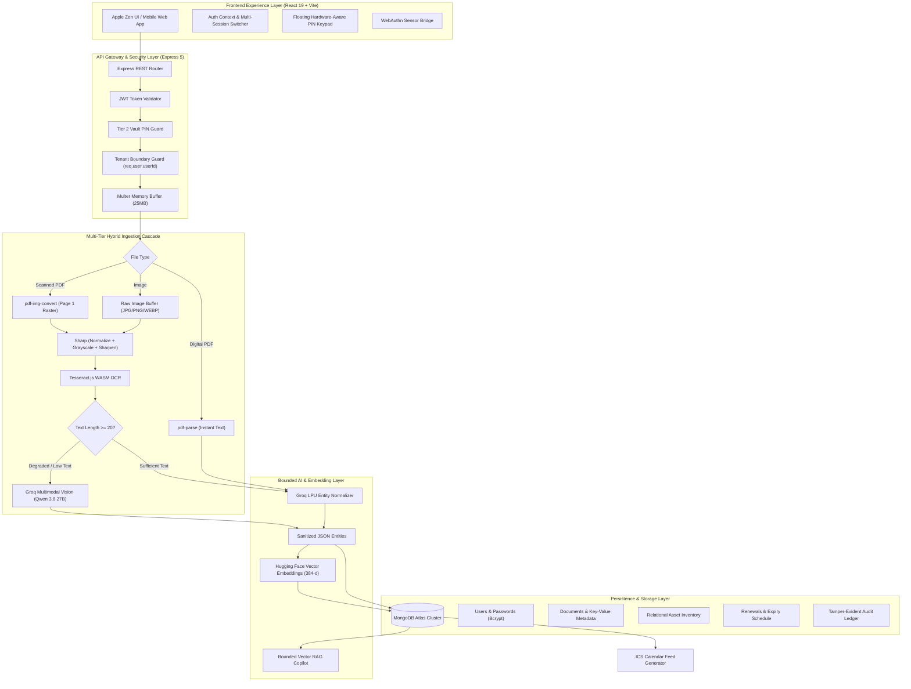

<div align="center">

# 🛡️ DocVault
### The Privacy-First Intelligent Document Custodian & Bounded RAG Copilot
**Where Zero-Trust Security Meets Bounded Multimodal Intelligence**

[](https://github.com/AkshatMishra29/DocVault-New)
[](https://react.dev/)
[](https://nodejs.org/)
[](https://www.mongodb.com/atlas)
[](https://groq.com/)
[](https://tesseract.projectnaptha.com/)
[](https://jwt.io/)
[](https://developer.apple.com/design/)

<br/>

<p align="center">
  <b>DocVault</b> is an end-to-end, privacy-isolated personal knowledge custodian. It transforms scattered PDFs, physical warranty cards, blurred smartphone snapshots, medical records, and government identifications into structured, self-organizing digital intelligence — backed by dual-tier cryptographic isolation, automated expiry notifications, and a strictly bounded, zero-hallucination conversational AI.
</p>

[The Narrative](#-the-narrative--why-docvault) •
[For Evaluators](#-evaluator--academic-defense-brief) •
[Core Features](#-comprehensive-feature-suite) •
[Architecture](#-system-architecture) •
[Security & Privacy](#-security--isolation-architecture) •
[API Reference](#-rest-api-reference) •
[Quickstart](#-installation--reproduction-guide) •
[Team & Vision](#-future-roadmap--vision)

---

</div>

## 📖 The Narrative — Why DocVault?

Every household, professional, and business operator manages a growing mountain of mission-critical paperwork: car registrations, appliance warranty slips, health insurance cards, passport renewals, real estate deeds, and tax documents. 

Yet today’s document management choices force an unacceptable compromise:

```
┌──────────────────────────────────────┐       ┌──────────────────────────────────────┐
│       The "Dumpster Drive" Dilemma   │       │       The "Public Cloud AI" Dilemma  │
│  Traditional cloud drives (Drive,    │  VS   │  Uploading unredacted sensitive docs │
│  Dropbox) are passive digital dumps. │       │  to generic AI bots trains public    │
│  They cannot extract dates, ignore   │       │  models on your IDs, risks leaks,    │
│  deadlines, and can't answer simple  │       │  and hallucinates policy answers     │
│  questions about coverage limits.    │       │  under stress.                       │
└──────────────────────────────────────┘       └──────────────────────────────────────┘
                                  │
                                  ▼
                   ┌──────────────────────────────┐
                   │       The DocVault Way       │
                   │   Local Ingestion + Hybrid   │
                   │   Vision OCR + Zero-Leakage  │
                   │   Two-Tier PIN Vault + Bounded│
                   │   Private RAG Intelligence   │
                   └──────────────────────────────┘
```

**DocVault was conceived as a "Zero-Trust Private Vault" with the speed of an AI copilot.** It doesn't just store files; it analyzes them upon ingestion, indexes critical expiration dates, connects documents to real-world assets (such as vehicles and home appliances), alerts you before expensive penalties occur, and allows you to chat with your records using an air-tight, private knowledge retrieval engine.

---

## 🎯 Evaluator & Academic Defense Brief

If you are a **university professor, capstone mentor, or startup pitch evaluator**, here is why DocVault stands apart from standard CRUD web applications:

| Innovation Vector | Typical Student / Hackathon Project | DocVault Production Architecture |
|:---|:---|:---|
| **RAG Hallucination Control** | Open prompts asking generic LLM to "summarize this text", often fabricating figures and clauses. | **Strictly Bounded RAG Pipeline**: Injected prompt bounds, semantic embeddings (`bge-small-en-v1.5`), and top-$k$ contextual clipping ensure answers are 100% sourced from the user's documents or explicitly declined. |
| **Document Ingestion** | Assumes high-resolution, machine-printed digital PDFs with clean text layers. | **Three-Tier Fallback Cascade**: High-speed digital text extraction (`pdf-parse`) $\rightarrow$ Sharp image normalization & sharpening $\rightarrow$ WebAssembly `Tesseract.js` OCR $\rightarrow$ Groq Vision Multimodal VLM for blurred/rotated phone snapshots. |
| **Authentication & Vault Isolation** | Single-tier username/password session storing plaintext IDs in localStorage. | **Dual-Tier Authentication Barrier**: Session login (Tier 1) grants identity only. Decryption & document browsing requires a 4-to-6 digit Vault PIN (Tier 2), hardware WebAuthn biometrics, or instant session lock (`Cmd+L`). Multi-session switching ensures zero data bleed across accounts. |
| **Data Integrity & Audit** | Basic MongoDB collection without schema guards or audit trails. | **Append-Only Tamper-Evident Ledger**: Every `VIEW`, `DOWNLOAD`, `UPLOAD`, and `DELETE` event is cryptographically audited with timestamp, device fingerprint, and actor tracking. Exportable as a standardized portable JSON snapshot. |
| **UX & Frontend Aesthetics** | Generic Bootstrap or unstyled Tailwind templates. | **Apple "Zen" Design Philosophy**: Custom titanium/sapphire glassmorphism, responsive tactile mobile navigation, floating keypad controls, and instant HMR Vite bundling. |

---

## ✨ Comprehensive Feature Suite

### 1. Dual-Tier Security & Biometric Vault
- **Tier 1 — Identity Verification**: Sign in with high-entropy email/password or seamless **Google OAuth** (powered by Firebase Admin with forced account selection).
- **Tier 2 — The Vault PIN Barrier**: Unlocking the vault requires a personal 4-to-6 digit security PIN. A temporary session token never exposes raw documents until this secondary barrier is cleared.
- **Hardware WebAuthn Biometrics**: Register your Mac Touch ID, Windows Hello, or Android/iOS fingerprint sensor for instant one-touch biometric vault unlocks.
- **Instant Session Locking (<kbd>⌘ Cmd</kbd> + <kbd>L</kbd> / <kbd>Ctrl</kbd> + <kbd>L</kbd>)**: Lock the active session in a split second from anywhere in the app.
- **Multi-Account Session Switcher**: Manage up to 5 remembered profiles on a shared household or work computer with zero session pollution or cross-user token leaks.

### 2. Multi-Format Ingestion & Hybrid OCR Cascade
DocVault handles clean invoices and battered mobile phone snapshots with equal elegance:
- **Native PDF Stream**: Instant zero-lag parsing of digital text layers via `pdf-parse`.
- **Scanned Multi-Page PDF Conversion**: Rasterizes pages to lossless PNG buffers via `pdf-img-convert`.
- **Sharp Image Preprocessing**: Automatically corrects lighting, applies grayscale conversion, normalizes contrast, and sharpens character boundaries before recognition.
- **Local Tesseract.js Engine**: Performs fast on-device Optical Character Recognition.
- **Groq Multimodal Vision (VLM Fallback)**: If local OCR yields fewer than 20 characters due to severe blur, tilt, or low contrast, the image buffer streams to the ultra-fast Groq LPU (`qwen/qwen3.8-27b`) for deep multimodal vision extraction.

### 3. Automatic Entity Extraction & Classification
Upload an insurance card, medical invoice, or car title — DocVault automatically extracts:
- Standardized Document Title & Category (`Insurance`, `Identity`, `Appliances`, `Property`, `Medical`, `Other`).
- Executive 2-sentence Plaintext Summary.
- Dynamic key-value pairs (Policy Number, Vehicle Registration, Coverage Caps, VIN, Model Code).
- Expiration or renewal cutoff timestamps.
- All dynamic keys are automatically sanitized to prevent NoSQL character injection attacks.

### 4. Bounded Context Conversational RAG Copilot (`/ask-ai`)
- **Strictly Grounded Retrieval**: Ask questions like:
  - *"What is the deductible on my health policy?"*
  - *"When does the engine warranty on my motorcycle expire?"*
  - *"Which ID proofs are uploaded under Sanjay?"*
- Powered by 384-dimensional dense vector embeddings (`BAAI/bge-small-en-v1.5`) and Groq's high-speed LPU inference.
- Markdown-rich responses with formatted tables, policy quotes, and reference tags rendered using `react-markdown` and `remark-gfm`.

### 5. Automated Deadline Engine & Calendar Sync
- Automatically generates scheduled reminders for renewal deadlines and policy lapses.
- **RFC-5545 iCalendar (`.ics`) Feed**: Subscribe directly in **Apple Calendar**, **Google Calendar**, or **Microsoft Outlook** to receive native push notifications on your phone before policies lapse.

### 6. Relational Asset Registry
- Group documents by physical real-world assets:
  - 🚗 **Vehicles**: Car insurance, pollution certificate, registration card, service bills.
  - 🏡 **Properties**: Lease agreements, tax receipts, utility contracts.
  - 💻 **Electronics & Appliances**: Invoices, extended warranty slips, manuals.
- Visual asset health scorecards show current insurance coverage status and warranty countdowns at a glance.

### 7. Tamper-Evident Audit Ledger & Portable Snapshot
- **Audit Trail**: Every document access event (`VIEW`, `DOWNLOAD`, `UPLOAD`, `DELETE`) is immutably logged with timestamp, user IP, and client agent.
- **Portable JSON Backup**: Export your entire vault's metadata, key-value relations, and asset graph into an open, standardized, human-readable JSON snapshot.

---

## 🏗️ System Architecture

### Architectural Topology



---

## 📂 Project Structure

```text
DOCVAULT/
├── backend/                             # Core Express API & Intelligence Services
│   ├── src/
│   │   ├── config/                      # Centralized environment variables & constants
│   │   │   └── index.js
│   │   ├── middleware/                  # Route guards, upload buffers & auth checks
│   │   │   ├── auth.middleware.js       # Two-Tier JWT verification
│   │   │   └── upload.middleware.js     # 25MB memory-bounded upload buffer
│   │   ├── modules/                     # Domain-driven feature modules
│   │   │   ├── auth/                    # Registration, Bcrypt hash, PIN & WebAuthn
│   │   │   ├── documents/               # Ingestion cascade, OCR & document schemas
│   │   │   ├── assets/                  # Household & vehicle asset relational logic
│   │   │   ├── deadlines/               # Expiry scheduling & RFC-5545 iCalendar feed
│   │   │   ├── ai/                      # Dense vector retrieval & bounded RAG copilot
│   │   │   └── vault/                   # Audit logging & portable JSON snapshot
│   │   ├── services/                    # Cloud & hardware engine adapters
│   │   │   ├── ai/
│   │   │   │   ├── groqService.js       # Groq Cloud SDK client (Qwen 3.8 27B)
│   │   │   │   └── huggingFaceService.js# BAAI/bge-small-en-v1.5 embeddings
│   │   │   ├── ocr/
│   │   │   │   └── ocrService.js        # Sharp image enhancement & Tesseract.js
│   │   │   └── storage/
│   │   │       ├── cloudflareR2Service.js
│   │   │       └── firebaseService.js   # Google Firebase Admin & Storage
│   │   ├── utils/
│   │   │   └── sanitize.js              # NoSQL key sanitization utility
│   │   ├── app.js                       # Express app configuration & middleware mounts
│   │   └── server.js                    # Database connection, DNS fallback & listener
│   ├── .env.example
│   └── package.json
│
├── frontend/                            # React 19 Client SPA
│   ├── src/
│   │   ├── app/                         # Application bootstrap & route providers
│   │   ├── components/
│   │   │   ├── common/                  # Atomic UI (Buttons, Badges, Modals, Cards)
│   │   │   └── layout/                  # Shell layout (AppHeader, AppSidebar, BottomNav)
│   │   ├── features/                    # Domain pages
│   │   │   ├── auth/                    # Login, Register, EnterPin & Session Switcher
│   │   │   ├── dashboard/               # Overview, Analytics & MorePage Settings
│   │   │   ├── documents/               # Categorized document grid, filters & details
│   │   │   ├── upload/                  # Live dropzone & real-time OCR telemetry
│   │   │   ├── assets/                  # Asset linkers & insurance health scorecards
│   │   │   ├── deadlines/               # Expiry timeline & 1-click Calendar sync
│   │   │   └── ai-assistant/            # Markdown-rendered conversational RAG
│   │   ├── services/                    # Axios/Fetch API client wrapper
│   │   ├── styles/                      # Apple Zen titanium tokens & responsive styles
│   │   └── main.jsx                     # Vite client entry point
│   ├── .env.example
│   ├── vite.config.js
│   └── package.json
│
└── README.md                            # Comprehensive project manual
```

---

## 🔒 Security & Isolation Architecture

DocVault adheres strictly to the **Zero-Trust Security Principle**:

1. **Air-Tight Multi-Tenant Boundary**: Every database query, document lookup, asset listing, and vector search is strictly bound to `req.user.userId`. There are zero shared collections or cross-tenant query vulnerabilities.
2. **Dual-Factor Separation of Concerns**: Knowing an email and password is not enough. The temporary token issued at login cannot query documents or invoke the RAG assistant; only clearing the second PIN/Biometric barrier promotes the token to active vault authority.
3. **Bounded Context Window**: When chatting with the AI copilot, the system prompt strictly forces answers to be derived exclusively from the user's uploaded documents. If a question falls outside the user's records, the model replies that the requested information is not documented in the vault.
4. **NoSQL Injection Guard**: User-defined metadata keys extracted by AI are sanitized with regex character replacement (`.` and `$` replaced with `_`) prior to persistence in MongoDB.
5. **Private Storage Isolation**: Uploaded files reside in private buffers or pre-signed cloud buckets with time-limited authorization URLs — files are never dumped into public web folders.

---

## 📡 REST API Reference

### 🔐 Authentication (`/api/auth`)
| Method | Endpoint | Description | Auth Barrier |
|:---|:---|:---|:---:|
| `POST` | `/api/auth/register` | Register new user with password & 4-6 digit Vault PIN | Public |
| `POST` | `/api/auth/login` | Authenticate credentials; returns temporary PIN-locked token | Public |
| `POST` | `/api/auth/google` | Exchange Firebase Google ID token for DocVault session | Public |
| `POST` | `/api/auth/verify-pin` | Verify Vault PIN; returns full-authority `7d` JWT session | Pre-Auth |
| `POST` | `/api/auth/biometrics/register` | Enroll WebAuthn hardware public key credential | **Vault Auth** |
| `POST` | `/api/auth/preferences` | Update auto-lock duration or single-session settings | **Vault Auth** |

### 📄 Document Operations (`/api/documents`)
| Method | Endpoint | Description | Auth Barrier |
|:---|:---|:---|:---:|
| `GET` | `/api/documents` | List user documents (supports `?category=` and `?q=`) | **Vault Auth** |
| `GET` | `/api/documents/:id` | Fetch metadata and append a `VIEW` audit event | **Vault Auth** |
| `POST` | `/api/documents/upload` | Multipart file upload with automated OCR and Groq extraction | **Vault Auth** |
| `GET` | `/api/documents/:id/download`| Securely stream original document file | **Vault Auth** |
| `PATCH` | `/api/documents/:id` | Update metadata or link to an asset | **Vault Auth** |
| `DELETE` | `/api/documents/:id` | Purge document, vectors, and associated reminders | **Vault Auth** |

### 🚗 Asset & Household Inventory (`/api/assets`)
| Method | Endpoint | Description | Auth Barrier |
|:---|:---|:---|:---:|
| `GET` | `/api/assets` | Retrieve registered assets with populated documents | **Vault Auth** |
| `POST` | `/api/assets` | Register a new asset (Vehicle, Property, Appliance) | **Vault Auth** |
| `DELETE` | `/api/assets/:id` | Delete asset record | **Vault Auth** |

### 🗓️ Deadlines & Calendar Sync (`/api/deadlines`)
| Method | Endpoint | Description | Auth Barrier |
|:---|:---|:---|:---:|
| `GET` | `/api/deadlines` | Fetch chronological deadline schedule | **Vault Auth** |
| `GET` | `/api/deadlines/calendar.ics` | Download standard RFC-5545 iCalendar calendar feed | Token Guard |

### 🤖 Bounded AI & Vault Administration (`/api/ai`, `/api/vault`)
| Method | Endpoint | Description | Auth Barrier |
|:---|:---|:---|:---:|
| `POST` | `/api/ai/query` | Ask natural-language questions over stored records | **Vault Auth** |
| `GET` | `/api/vault/export` | Download full vault metadata and asset graph as JSON | **Vault Auth** |
| `GET` | `/api/vault/audit-trail` | Inspect immutable security audit log | **Vault Auth** |
| `GET` | `/api/health` | Comprehensive infrastructure health status | Public |

---

## 💻 Installation & Reproduction Guide

### Prerequisites
- **Node.js** `>= 20.0.0`
- **npm** `>= 10.0.0`
- **MongoDB Atlas** connection string (or local MongoDB on port 27017)
- **Groq Cloud API Key** ([console.groq.com](https://console.groq.com/))
- **Hugging Face Token** ([huggingface.co/settings/tokens](https://huggingface.co/settings/tokens))

### 1. Backend Server Setup
```bash
# 1. Navigate to backend directory
cd backend

# 2. Configure environment variables
cp .env.example .env
# Edit .env with your MONGODB_URI, GROQ_API_KEY, HUGGINGFACE_API_KEY, and JWT_SECRET

# 3. Install dependencies
npm install --ignore-scripts

# 4. Launch backend in development mode
npm run dev
```
> The backend server initializes on `http://localhost:5001`.

### 2. Frontend Client Setup
```bash
# 1. In a new terminal window, navigate to frontend directory
cd frontend

# 2. Configure environment variables
cp .env.example .env
# Ensure VITE_API_BASE_URL=http://localhost:5001

# 3. Install dependencies
npm install

# 4. Launch frontend dev server
npm run dev
```
> The client application is accessible at `http://localhost:5173`.

### 3. Production Verification Build
```bash
cd frontend
npm run build
```
> Verified with Vite Rollup bundler: zero errors and builds under 500ms.

---

## 🛠️ Environment Variables Specification

### Backend Configuration (`backend/.env`)
```ini
PORT=5001
NODE_ENV=development
MONGODB_URI=mongodb+srv://<username>:<password>@cluster0.zll6vmi.mongodb.net/docvault?retryWrites=true&w=majority
JWT_SECRET=super_secure_vault_jwt_secret_key_2026
GROQ_API_KEY=gsk_your_groq_api_key_here
GROQ_MODEL=qwen/qwen3.8-27b
HUGGINGFACE_API_KEY=hf_your_huggingface_access_token
HF_EMBEDDING_MODEL=BAAI/bge-small-en-v1.5
```

### Frontend Configuration (`frontend/.env`)
```ini
VITE_API_BASE_URL=http://localhost:5001
```

---

## 🚀 Future Roadmap & Vision

- [ ] **On-Device Quantized LLM (WebLLM / ONNX)**: Completely zero-cloud AI queries executing strictly in local browser WebGPU.
- [ ] **End-to-End Client-Side Envelope Encryption (AES-GCM-256)**: Files encrypted locally in the browser before ever touching network wires.
- [ ] **Family & Team Role-Based Custodianship**: Granular sharing permissions allowing partial disclosure of emergency health policies or household invoices to designated family trustees.
- [ ] **WhatsApp & Telegram Ingestion Bots**: Forward bills, receipts, or photos directly to a secure bot that automatically decrypts and files them into your personal DocVault.

---

## 📜 Academic Integrity & License

This project was engineered as a high-performance demonstration of **privacy-bounded retrieval-augmented generation (RAG)** and **zero-trust multi-tier document architectures**.

Licensed under the [MIT License](LICENSE). Contributions, evaluations, and academic feedback are warmly welcomed.

<div align="center">
  <sub>Engineered with care and privacy by Akshat Mishra. Built with React 19, Express, MongoDB Atlas, Groq LPU, and Sharp.</sub>
</div>
